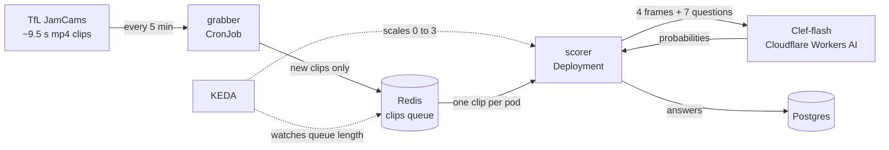

# Traffic with Clef

London traffic cameras, judged by a vision decision model every 5 minutes, on a Kubernetes cluster that scales itself to zero between runs.

Every 5 minutes a grabber checks TfL JamCam video clips. Each new clip goes onto a Redis queue. KEDA starts scorer pods only while clips are waiting. A scorer cuts 4 frames from the clip, asks [Clef-flash](https://developers.cloudflare.com/workers-ai/models/clef-flash/) on Cloudflare Workers AI seven questions about the road, and stores the answers in Postgres. Clips and frames are never saved.



## What the model answers

Clef-flash is a decision model: a Qwen3.5-9B vision-language backbone with a decision head. Instead of writing text, it returns a probability for each allowed answer, so results go straight into charts.

| Question | Type | Example answer |
|---|---|---|
| `usable` | yes/no | 0.88 |
| `congestion` | score, Empty to Standstill | 2.95 of 4, "Heavy" 73% |
| `moving` | yes/no, compares the 4 frames | 0.59 |
| `wet` | yes/no | 0.80 |
| `light` | choice: day, twilight, night | night 97% |
| `blocked` | yes/no | 0.28 |
| `heavy_vehicles` | score, None to Most | 1.13, "A few" 73% |

The questions live in [`services/scorer/questions.yaml`](services/scorer/questions.yaml) and are versioned; every stored answer records the version and the model string.

## Measured so far

| | |
|---|---|
| Clip | ~9.5 s, 352x288, 25 fps |
| Tokens per frame | 102 (11 x 9 patches of 32x32, plus 3) |
| Tokens per call | ~1,215 (4 frames + 808 for description and questions) |
| Call latency | 1.5 to 13 s, high variance; Cloudflare quotes 39 ms model time |
| Daily cost, 2 cameras | ~2,420 neurons, about 24% of the free 10,000 per day: $0 |

Results from the 24-hour run will be added here.

## Run it locally

Needs Docker, [kind](https://kind.sigs.k8s.io/), kubectl, Helm, and a Cloudflare account with a Workers AI API token.

```bash
cp .env.example .env      # fill in CF_ACCOUNT_ID and CF_API_TOKEN
make up                   # kind cluster, KEDA, secrets, images, deploy
make status               # pods, CronJob, ScaledObject
make grab                 # run the grabber now instead of waiting
make logs                 # watch scorers
make db                   # psql: select * from decisions;
make down                 # delete the cluster
```

Cameras are set in [`deploy/k8s/config.yaml`](deploy/k8s/config.yaml). Find camera ids with:

```bash
python -m venv .venv && .venv/bin/pip install -r requirements.txt
.venv/bin/python spike/spike.py --find "hyde park"
.venv/bin/python spike/spike.py --camera JamCams_00001.06514 --dry-run
```

## How it fits together

| Part | Kubernetes object | Notes |
|---|---|---|
| grabber | CronJob, `*/5 * * * *` | A clip is new when its ETag on TfL storage changes; TfL's API timestamps go stale |
| Redis | Deployment + Service | `clips` queue, `processing` list, last ETag per camera, daily neuron counter |
| scorer | Deployment, scaled by KEDA | One clip at a time per pod; finishes its clip on SIGTERM; retries 429 and 5xx up to 3 times |
| KEDA | ScaledObject | One pod per waiting clip, 0 to 3, back to 0 after 2 min of empty queue |
| Postgres | StatefulSet + 1 GiB volume | `decisions` table, unique per camera and clip, so retries never double-insert |
| Secrets | Secret | Cloudflare token copied from `.env`; Postgres password generated in the cluster |

The scorer counts neurons per UTC day in Redis and pauses at 95% of the free allowance (`PAUSE_AT`, `DAILY_NEURON_LIMIT`).

## Layout

```
services/grabber/      grabber.py, Dockerfile
services/scorer/       scorer.py, decision_client.py, questions.yaml, Dockerfile
db/schema.sql          decisions table
deploy/kind/           kind cluster config
deploy/k8s/            namespace, config, Redis, Postgres, grabber, scorer
deploy/keda/           ScaledObject (applied after KEDA is installed)
spike/spike.py         day 1 test script: one clip in, answers out
Makefile
```

## Data

Camera clips: [TfL JamCams](https://api.tfl.gov.uk/Place/Type/JamCam), Transport for London open data. Powered by TfL Open Data. Contains OS data © Crown copyright and database rights.
